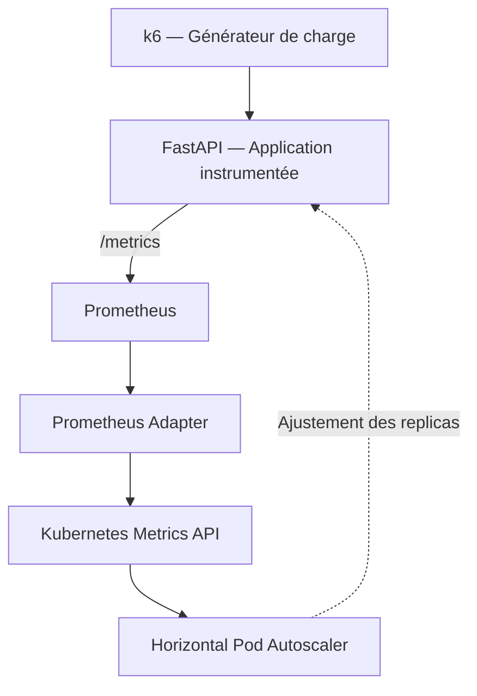

# HPA Metrics POC

**Démonstrateur d'autoscaling Kubernetes piloté par des métriques applicatives et externes, sans KEDA.**

## Objectif

Démontrer la capacité du Horizontal Pod Autoscaler (HPA) à ajuster dynamiquement le nombre de replicas d'une application Kubernetes à partir de métriques **Custom Metrics** et **External Metrics**, indépendamment des métriques traditionnelles CPU et mémoire.

Le POC permet d'expérimenter différents signaux d'autoscaling, de simuler des montées en charge et d'observer les décisions prises par Kubernetes.

## Architecture

**Stack :** Kubernetes (kind), FastAPI, Prometheus, Prometheus Adapter, HPA (`autoscaling/v2`) et k6.

## Documentation

| Document | Contenu |
|---|---|
| [Installation](docs/01-installation.md) | Construction et validation reproductibles de l'environnement |
| [Démonstration](docs/02-demonstration.md) | Scénarios de charge, configuration HPA et observations |
| [Architecture](docs/03-architecture.md) | Mécanismes techniques, choix d'architecture et limites |

## État d'avancement

- [x] Application FastAPI instrumentée
- [x] Collecte des métriques par Prometheus
- [x] Exposition des Custom Metrics à Kubernetes
- [ ] Autoscaling HPA piloté par les RPS
- [ ] Comparaison avec le HPA CPU
- [ ] Autoscaling sur External Metrics
- [ ] Scénarios de charge k6

**Périmètre :** démonstrateur technique local, destiné à l'expérimentation et à la validation de concepts d'architecture.
