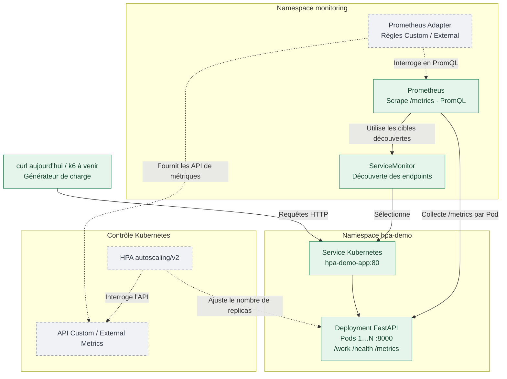

# POC Kubernetes — Autoscaling HPA avec métriques Prometheus

Ce dépôt regroupe un démonstrateur d'**autoscaling Kubernetes sans KEDA**, destiné à comparer un HPA classique piloté par CPU, un HPA piloté par **Custom Metrics** et un HPA piloté par **External Metrics**.

> **Avancement au 30 octobre 2026 :** FastAPI, le déploiement kind, Prometheus et la mesure du débit HTTP par Pod ont été validés. **Prometheus Adapter, les HPA et k6 restent à mettre en place.** Les scénarios futurs sont décrits comme des objectifs et non comme des résultats obtenus.

## Lire ce document

- **Partie I — Construire et reproduire l'environnement :** installation, manifests, commandes de vérification et incidents rencontrés.
- **Partie II — Storyboard de démonstration :** déroulé de la présentation, hypothèses, scénario par scénario, mesures à observer et messages d'architecture.

## Architecture fonctionnelle cible

Le diagramme distingue les composants **validés** (traits continus) des composants **à venir** (traits pointillés). Les flèches représentent les échanges et responsabilités, pas une chronologie d'installation.



La boucle de scaling sera évaluée plus tard. Le fait d'avoir une métrique Prometheus ne signifie pas encore qu'elle est exposée à l'API Kubernetes.

---

# Partie I — Construction reproductible de l'environnement

Cette partie permet de reconstruire le socle du POC indépendamment de la présentation. Le **bootstrap kind est externe à ce dépôt** ; il n'est pas redéfini ici.

## I.1. Organisation du dépôt

```text
hpa-metrics-poc/
├── app/
│   ├── main.py                     # API FastAPI et instrumentation Prometheus
│   ├── requirements.txt
│   ├── Dockerfile
│   └── k8s/
│       ├── namespace.yaml
│       ├── deployment.yaml         # Image à adapter à la méthode choisie (section I.4)
│       └── service.yaml
├── infra/
│   ├── prometheus/
│   │   ├── values.yaml             # Helm kube-prometheus-stack minimal
│   │   ├── servicemonitor.yaml     # Scrape de l'application
│   │   └── README.md              # Notes complémentaires éventuelles
│   └── prometheus-adapter/         # À implémenter : exposition Custom/External Metrics
├── autoscaling/                    # À implémenter : manifests HPA
├── load-tests/                     # À implémenter : scénarios k6
├── Makefile                        # À automatiser
└── README.md
```

Les répertoires `prometheus-adapter/`, `autoscaling/` et `load-tests/` peuvent être vides à ce stade. Ils correspondent aux étapes prévues, pas à des fonctionnalités déjà opérationnelles.


## I.2. Prérequis

- Cluster **kind** opérationnel, créé **en dehors de ce dépôt** à l'aide du bootstrap existant. Le README ne recrée ni ne configure ce cluster.
- `kubectl` pointant sur le cluster voulu ; `helm`, `docker`, `curl` installés.
- Pour la méthode registry locale : registry exposée par le bootstrap et `skopeo` installé (`sudo pacman -S skopeo` sous Arch Linux).
- Pour la méthode directe : CLI `kind` installée et accès au daemon Docker des nœuds kind.
- Un port local libre pour les `kubectl port-forward` : `8081` pour l'application et `9090` pour Prometheus dans les exemples.

**Valeurs utilisées lors de la validation :**

| Paramètre | Valeur |
|---|---|
| Cluster kind | `hpa-metrics-autoscaling` |
| Namespace applicatif | `hpa-demo` |
| Namespace monitoring | `monitoring` |
| Deployment / Service | `hpa-demo-app` |
| Registry de ce bootstrap | `registry.hpa-metrics-autoscaling.local:5001` |
| Image en registry | `registry.hpa-metrics-autoscaling.local:5001/hpa-poc/fastapi:v0.1.0` |
| Image locale | `hpa-demo-app:0.1.0` |
| Release Helm | `hpa-monitoring` |

Sur un autre cluster, **adapter les noms** et vérifier les paramètres de la registry : son DNS, son port, le certificat et la configuration `containerd` ne sont pas universels.

```bash
kubectl config current-context
kind get clusters
kubectl get nodes
```


## I.3. Construire et tester FastAPI

L'API contient :

| Endpoint | Comportement |
|---|---|
| `GET /health` | Retourne `{"status":"ok"}` ; ne représente pas une readiness métier approfondie. |
| `GET /work?mode=cpu&duration_ms=100` | Boucle CPU bornée (dans un thread) pendant environ 100 ms. |
| `GET /work?mode=io&duration_ms=500` | Attente asynchrone simulant un I/O de 500 ms. |
| `GET /metrics` | Expose les métriques au format Prometheus. |
| `GET /docs` | Documentation OpenAPI/Swagger. |

`duration_ms` est compris entre 1 et 5 000 ms. L'endpoint `/work` renvoie également le nom du Pod via `HOSTNAME`.

Métriques émises :

| Nom | Type | Usage |
|---|---|---|
| `demo_http_requests_total` | Counter | Nombre de requêtes `/work` terminées ; le `rate()` permet le RPS. |
| `demo_http_requests_in_progress` | Gauge | Nombre de requêtes `/work` en cours sur l'instance. |
| `demo_http_request_duration_seconds` | Histogram | Durées des traitements `/work`. |

> Les labels `namespace` et `pod` sont ajoutés par la chaîne de découverte/scraping Kubernetes, **pas** directement dans le code FastAPI.

À la racine du repo :

```bash
docker build -t hpa-demo-app:0.1.0 ./app
docker run --rm -p 8000:8000 hpa-demo-app:0.1.0
```

Depuis un deuxième terminal :

```bash
curl http://localhost:8000/health
curl 'http://localhost:8000/work?mode=cpu&duration_ms=200'
curl -s http://localhost:8000/metrics | grep '^demo_'
```

Si le port 8000 est déjà occupé par un ancien conteneur de test, arrêter celui-ci ou utiliser un autre port hôte (`-p 8001:8000`).


## I.4. Publier ou charger l’image dans kind

Le déploiement Kubernetes **doit référencer l'image correspondant à la méthode choisie**. Le manifeste initial `app/k8s/deployment.yaml` utilisait `hpa-demo-app:0.1.0` ; lors de la validation, il a été modifié pour la registry locale.

### Option A — Registry locale avec Skopeo (méthode utilisée et validée)

Le bootstrap a créé le conteneur `hpa-metrics-autoscaling-registry` et configuré les nœuds kind pour accéder à la registry locale. Pour ce projet, celle-ci est joignable sous :

```text
registry.hpa-metrics-autoscaling.local:5001
```

Le `docker push` classique a échoué à cause de :

```text
tls: failed to verify certificate: x509: certificate signed by unknown authority
```

Le contournement **limité au POC local** a consisté à utiliser Skopeo sans vérifier le certificat TLS de la **destination** (pas de modification permanente du daemon Docker) :

```bash
docker build -t hpa-demo-app:0.1.0 ./app

skopeo copy \
  --dest-tls-verify=false \
  docker-daemon:hpa-demo-app:0.1.0 \
  docker://registry.hpa-metrics-autoscaling.local:5001/hpa-poc/fastapi:v0.1.0

skopeo inspect \
  --tls-verify=false \
  docker://registry.hpa-metrics-autoscaling.local:5001/hpa-poc/fastapi:v0.1.0
```

Vérifier que `app/k8s/deployment.yaml` contient :

```yaml
image: registry.hpa-metrics-autoscaling.local:5001/hpa-poc/fastapi:v0.1.0
imagePullPolicy: IfNotPresent
```

**Attention :** le contournement TLS de Skopeo ne concerne que la publication. Le pull depuis les nœuds dépend des réglages `containerd` fournis par le bootstrap. Ne pas utiliser cette désactivation de vérification pour une registry de production ou non maîtrisée.

### Option B — Charger directement l'image dans kind (alternative, non encore testée ici)

Pour se passer entièrement de publication en registry dans ce POC :

```bash
docker build -t hpa-demo-app:0.1.0 ./app
kind load docker-image hpa-demo-app:0.1.0 --name hpa-metrics-autoscaling
```

Revenir alors, dans `app/k8s/deployment.yaml`, à :

```yaml
image: hpa-demo-app:0.1.0
imagePullPolicy: IfNotPresent
```

La commande `kind load` copie l'image sur les nœuds kind ; elle ne configure aucune registry. Avec un tag réutilisé, s'assurer que les Pods utilisent la bonne version (suppression/redémarrage des Pods si nécessaire). Pour des tests reproductibles, préférer des tags d'image immuables ou incrémentés.


## I.5. Déployer FastAPI

Avec **l'une des deux options d'image déjà réalisées** :

```bash
kubectl apply -f app/k8s/namespace.yaml
kubectl apply -f app/k8s/deployment.yaml
kubectl apply -f app/k8s/service.yaml

kubectl rollout status deployment/hpa-demo-app -n hpa-demo --timeout=120s
kubectl get pods,svc -n hpa-demo
```

Configuration initiale : `replicas: 1`, request CPU `100m`, limit CPU `1`, request mémoire `64Mi`, limit mémoire `256Mi`. Les probes `liveness` et `readiness` appellent `/health`.

**Validation HTTP :**

```bash
kubectl port-forward -n hpa-demo svc/hpa-demo-app 8081:80
```

Dans un autre terminal :

```bash
curl http://localhost:8081/health
curl 'http://localhost:8081/work?mode=cpu&duration_ms=200'
curl -s http://localhost:8081/metrics | grep '^demo_'
```

Le Service est de type `ClusterIP` (port `80` vers port conteneur `8000`, nommé `http`).


## I.6. Installer Prometheus et le ServiceMonitor

Configuration minimaliste via `kube-prometheus-stack`, sans Grafana, Alertmanager, règles d'alerte ni exporteurs de métriques d'infrastructure non nécessaires au POC. Le `values.yaml` fixe notamment un intervalle de scrape de 10 s et une rétention de 6 h.

```bash
kubectl create namespace monitoring \
  --dry-run=client -o yaml | kubectl apply -f -

helm repo add prometheus-community https://prometheus-community.github.io/helm-charts
helm repo update

helm upgrade --install hpa-monitoring \
  prometheus-community/kube-prometheus-stack \
  --namespace monitoring \
  -f infra/prometheus/values.yaml

kubectl get pods -n monitoring
```

Pour une reproductibilité stricte à terme, **figer la version du chart Helm** avec `--version`, et éventuellement les versions/digests des images. La procédure ci-dessus installe la version disponible du chart au moment de l'exécution.

### ServiceMonitor

```bash
kubectl apply -f infra/prometheus/servicemonitor.yaml
kubectl get servicemonitor -n monitoring
```

Le `ServiceMonitor` `hpa-demo-app` est dans `monitoring`. Il sélectionne le Service dans `hpa-demo` via le label `app: hpa-demo-app` et son port nommé `http` ; Prometheus le sélectionne via `monitoring: hpa-poc` (configuré dans `values.yaml`).

La **création** du `ServiceMonitor` ne garantit pas à elle seule que Prometheus scrape la cible : vérifier ensuite la série `up`.


## I.7. Vérifier la collecte Prometheus

Ouvrir Prometheus (terminal dédié) :

```bash
kubectl port-forward -n monitoring \
  svc/hpa-monitoring-kube-promet-prometheus 9090:9090
```

Interface : <http://localhost:9090>.

**Étape 1 — Vérifier la cible :**

```promql
up{namespace="hpa-demo"}
```

Attendu : série `job="hpa-demo-app"`, avec `namespace="hpa-demo"`, `pod="..."`, et valeur **`1`**. Cela a été observé lors du POC.

**Étape 2 — Vérifier le compteur brut :**

```promql
demo_http_requests_total{mode="cpu",namespace="hpa-demo"}
```

**Étape 3 — Simuler un trafic continu :**

Garder le port-forward applicatif de la section I.5 actif, puis dans un nouveau terminal :

```bash
while true; do
  curl -fsS 'http://localhost:8081/work?mode=cpu&duration_ms=100' > /dev/null || break
done
```

Pour arrêter : `Ctrl+C`. La boucle est **séquentielle**, avec un débit théorique proche de 10 RPS et un débit réel légèrement inférieur selon les overheads. Elle ne constitue pas un véritable test de charge concurrente : les scénarios k6 viendront ensuite.

**Étape 4 — Calculer le RPS par Pod :**

```promql
sum by (namespace, pod) (
  rate(demo_http_requests_total{mode="cpu"}[1m])
)
```

**Résultat effectivement observé :** une série pour `hpa-demo-app-5969b75477-rdbp7`, montant de 0 à **environ 9 RPS** pendant la boucle `curl`.

Le calcul nécessite au moins deux échantillons et reflète une moyenne sur la fenêtre glissante de 1 minute. À l'arrêt du trafic, la valeur diminue progressivement vers zéro.

**Attention à l'interface Prometheus :** en cas de graphique figé à zéro, vérifier que la plage temporelle n'est pas ancrée sur une ancienne heure. Revenir à une plage relative (par exemple `5m`) et réexécuter la requête.


## I.8. Diagnostic et incidents rencontrés

| Symptôme | Explication | Vérification / résolution |
|---|---|---|
| `ImagePullBackOff` | Image locale inconnue des nœuds kind ou registry inaccessible | Utiliser la méthode A ou B (section I.4), vérifier image et `imagePullPolicy` |
| `docker push` échoue avec `x509: certificate signed by unknown authority` | Docker ne fait pas confiance à la CA TLS de la registry locale | Publication via `skopeo copy --dest-tls-verify=false` dans ce lab |
| `1 old replicas are pending termination` | Ancien Pod en cours de terminaison pendant le RollingUpdate | Attendre `kubectl rollout status`; succès effectivement observé |
| `ServiceMonitor` existe, mais aucune série `up` | Sélecteur Prometheus/ServiceMonitor ou labels/port du Service mal alignés | Contrôler `values.yaml`, labels et `kubectl get svc -o yaml` |
| RPS égal à zéro | Pas de nouvelles requêtes sur 1 min, ou graphique évalué dans le passé | Générer des requêtes et actualiser le temps dans Prometheus |

Commandes utiles :

```bash
kubectl get pods -n hpa-demo -o wide
kubectl get events -n hpa-demo --sort-by=.lastTimestamp
kubectl describe deployment hpa-demo-app -n hpa-demo
kubectl logs -n hpa-demo deployment/hpa-demo-app
kubectl get servicemonitor -n monitoring
```


---

# Partie II — Storyboard de démonstration

## II.1. Objectif de la présentation

Montrer à un groupe d'architectes qu'un **HPA peut dimensionner une application à partir d'un signal applicatif ou métier**, sans KEDA, en explicitant le rôle de chaque composant et les limites du raisonnement « davantage de Pods = davantage de performance ».

**Fil conducteur :** une application FastAPI expose des métriques ; Prometheus les collecte ; Prometheus Adapter les publie dans les API de métriques Kubernetes ; le HPA ajuste le nombre de replicas ; un générateur de charge permet de voir la boucle complète.

### Conventions de démonstration

| Paramètre | Valeur ou choix |
|---|---|
| Cluster | `hpa-metrics-autoscaling` |
| Application / namespace | `hpa-demo-app` / `hpa-demo` |
| Observabilité / namespace | Prometheus / `monitoring` |
| État initial | 1 replica ; HPA désactivé lors des premières observations |
| Charge de validation initiale | `curl` séquentiel, mode CPU, 100 ms par requête |
| Générateur de charge des scénarios suivants | k6, à implémenter |
| Critères à observer | RPS, latence, saturation, disponibilité des métriques, replicas désirés et disponibles |

Les seuils HPA indiqués ci-dessous sont **des paramètres pédagogiques à tester**, non des niveaux de service validés pour une application réelle.

## II.2. Séquence de présentation

| Acte | Manipulation | Ce que l'on veut montrer | État |
|---|---|---|---|
| 0 — État initial | Contrôler le Pod et `/health` | Une application saine mais sans autoscaling | Validé |
| 1 — Instrumentation | Interroger `/metrics` et le compteur brut | L'application mesure son activité | Validé |
| 2 — Collecte | Afficher `up` puis le RPS dans Prometheus | La découverte Kubernetes produit des séries par Pod | Validé |
| 3 — Adaptation | Interroger `custom.metrics.k8s.io` | Kubernetes peut lire une métrique applicative | À réaliser |
| 4 — Scaling RPS | Activer le HPA Custom et une charge k6 par paliers | La charge modifie le nombre de replicas | À réaliser |
| 5 — Comparaison CPU | Rejouer la charge avec HPA CPU | Deux signaux peuvent produire des décisions différentes | À réaliser |
| 6 — External Metrics | Simuler une file et piloter un HPA External | Une charge globale peut piloter des Pods | À réaliser |
| 7 — Limites | Montrer les délais et un goulot en amont | Le scaling n'est pas une garantie de performance | À réaliser |

## II.3. Scénario 0 — Vérifier l'état initial (validé)

**Action :** afficher les objets et vérifier la disponibilité HTTP.

```bash
kubectl get deploy,pods,svc -n hpa-demo
kubectl port-forward -n hpa-demo svc/hpa-demo-app 8081:80
# Dans un autre terminal :
curl http://localhost:8081/health
```

**Message :** le Deployment fonctionne avec un seul replica. La readiness `/health` est un contrôle élémentaire : elle ne garantit pas qu'un Pod ait terminé son warmup ou puisse répondre aux requêtes métier dans un temps acceptable.

## II.4. Scénario 1 — Observer l'instrumentation et la collecte (validé)

**Action :** ouvrir Prometheus (section I.7) ; vérifier successivement :

```promql
up{namespace="hpa-demo"}
```

```promql
demo_http_requests_total{mode="cpu",namespace="hpa-demo"}
```

Faire tourner la boucle `curl` documentée en section I.7, puis afficher :

```promql
sum by (namespace, pod) (
  rate(demo_http_requests_total{mode="cpu"}[1m])
)
```

**Résultat observé lors de la construction :** environ **9 RPS** sur un Pod pour des requêtes CPU de 100 ms, en boucle séquentielle. Cette valeur n'est pas une mesure de capacité maximale : un seul client envoie une requête après l'autre.

**Message :** Prometheus est responsable de la collecte et du calcul ; les labels `namespace` et `pod` servent à rattacher la mesure au workload Kubernetes.

## II.5. Scénario 2 — Exposer les Custom Metrics (à réaliser)

**Préparation :** déployer Prometheus Adapter et une règle mappant les séries `demo_http_requests_total` vers une métrique HPA de type `Pods` (nom envisagé : `http_requests_per_second`).

**Action :** inspecter l'API d'agrégation puis interroger la valeur par Pod :

```bash
kubectl get apiservice | grep custom.metrics
kubectl get --raw /apis/custom.metrics.k8s.io/v1beta1
# Après définition du nom de métrique et des règles :
kubectl get --raw '/apis/custom.metrics.k8s.io/v1beta1/namespaces/hpa-demo/pods/*/http_requests_per_second'
```

**Message :** le HPA ne lit pas directement Prometheus : il interroge l'API Kubernetes, alimentée par l'adapter. La commande finale ne sera exploitable qu'après installation et configuration de celui-ci.

## II.6. Scénario 3 — Autoscaling sur RPS (à réaliser)

**Hypothèse de test :** HPA `Pods` ciblant **5 RPS moyens par Pod** ; charge k6 à débit maîtrisé, progressivement supérieure à cette cible. Exemple théorique : à 9 RPS sur 1 Pod, le HPA pourrait demander 2 replicas. Le résultat concret dépend des métriques disponibles, de l'algorithme, des politiques HPA et des délais de stabilisation.

**Actions :** activer `autoscaling/hpa-custom-rps.yaml` une fois créé ; lancer un scénario k6 par paliers ; suivre simultanément :

```bash
kubectl get hpa -n hpa-demo -w
kubectl get pods -n hpa-demo -w
kubectl describe hpa -n hpa-demo hpa-demo-app
```

Observer le RPS **par Pod**, le RPS global, les latences et les replicas désirés/réellement disponibles. Faire ensuite redescendre la charge et expliquer la stabilisation de la descente en capacité.

**Message :** une cible par Pod régule la charge moyenne, mais le HPA ne crée pas instantanément des Pods disponibles. L'efficacité dépend aussi de leur readiness et de leur temps de démarrage.

## II.7. Scénario 4 — Comparer le HPA CPU au HPA RPS (à réaliser)

**Actions :** rejouer une charge comparable avec une politique HPA basée sur CPU, puis avec le HPA RPS. Éviter deux HPA concurrents pilotant simultanément le même Deployment : désactiver l'un avant d'activer l'autre.

**Observations :** délai de réaction, évolution CPU, latence, replicas, éventuel throttling. Comparer les modes `cpu` et `io` : une requête lente n'est pas nécessairement gourmande en CPU.

**Message :** le signal retenu dépend du goulot à traiter. Le CPU est pertinent pour certaines charges ; une métrique métier ou applicative peut mieux refléter la pression réelle dans d'autres cas.

## II.8. Scénario 5 — External Metrics sur une file simulée (à réaliser)

**Préparation :** exposer une jauge globale `queue_messages_pending` sans la rattacher individuellement aux Pods et configurer la règle `externalRules` de Prometheus Adapter.

**Hypothèse de test :** HPA de type `External` avec cible `AverageValue: 100` messages par Pod. Une profondeur de file de 450 messages conduirait théoriquement à viser 5 replicas, sous réserve des limites et règles HPA.

**Message :** une Custom Metric est associée à des ressources Kubernetes (`Pods` ou `Object`) ; une External Metric représente une mesure externe à ces objets, même si elle est collectée par un Prometheus hébergé dans le cluster.

## II.9. Scénario 6 — Discuter les limites de l'autoscaling (à réaliser)

Une démonstration techniquement réussie doit aussi expliciter ce que le scaling **ne résout pas** :

- **Délais de bout en bout :** intervalle de scrape, fenêtre `rate`, découverte par l'adapter, synchronisation HPA, scheduling, démarrage et readiness des Pods.
- **Warmup et readiness :** un Pod déclaré Ready trop tôt peut recevoir du trafic avant d'être réellement capable de le traiter.
- **Goulot en amont :** throttling APIM ou gateway, quotas et limites réseau peuvent empêcher la hausse des replicas d'améliorer le débit utile.
- **Qualité du signal :** RPS, concurrence, latence et profondeur de file ne mesurent pas la même chose ; chaque cible nécessite une justification.
- **Validité du test :** une boucle `curl` séquentielle illustre le principe mais ne remplace pas un test de charge concurrente et reproductible avec k6.

## II.10. Critères de réussite et feuille de route

| Critère | État au 30/10/2026 |
|---|---|
| Image FastAPI disponible et Pod opérationnel sur kind | ✅ Validé |
| `/metrics` avec compteur, jauge et histogramme | ✅ Validé |
| Prometheus découvre le Service via `ServiceMonitor` | ✅ Validé |
| `up = 1` et calcul des RPS par Pod | ✅ Validé |
| Adapter expose une métrique Custom lisible dans Kubernetes | À faire |
| HPA Custom modifie effectivement les replicas | À faire |
| Tests par paliers instrumentés avec k6 | À faire |
| Comparaison HPA CPU / RPS | À faire |
| HPA External sur file simulée | À faire |
| Analyse des latences, limites et temps de réaction | À faire |
| Automatisation et versions figées (Helm / images) | À faire |

### Suite prévue

Implémenter `infra/prometheus-adapter/`, valider **d'abord** l'API `custom.metrics.k8s.io`, puis ajouter le manifeste HPA Custom et le test k6 associé. Les étapes External Metrics viendront ensuite.
