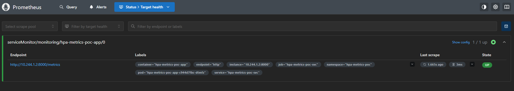

# Construction et validation de l'environnement du POC

Ce guide permet de reconstruire le socle technique du projet **hpa-metrics-poc**, depuis le cluster kind jusqu'à l'exposition d'une métrique applicative par l'API Kubernetes `custom.metrics.k8s.io`.

Les commandes sont exécutées **depuis la racine du dépôt**, sauf indication contraire. Le déploiement des HPA et les tests comparatifs d'autoscaling relèvent de [`02-demonstration.md`](02-demonstration.md).

## 1. Bootstrap Kubernetes et application FastAPI

### 1.1. Création du cluster

Le projet utilise [platform-bootstrap](https://github.com/BazinFlorent/platform-dev-bootstrap) pour créer un cluster kind à trois nœuds et son infrastructure locale. La registry OCI du bootstrap n'est pas nécessaire au déploiement de l'application dans ce POC.

```bash
platform-bootstrap -n hpa-metrics-poc bootstrap
```

Vérifier le cluster et le contexte actif :

```bash
kind get clusters
kubectl config current-context
kubectl get nodes -o wide
```

**Attendu :** cluster `hpa-metrics-poc`, contexte `kind-hpa-metrics-poc` et trois nœuds `Ready` (un control-plane, deux workers), sous Kubernetes `v1.37.0` dans l'environnement validé.

En cas de contexte absent :

```bash
kind export kubeconfig --name hpa-metrics-poc
```

### 1.2. Construction et chargement de l'image

```bash
docker build -t hpa-metrics-poc-app:0.1.1 ./app
docker image ls hpa-metrics-poc-app

kind load docker-image hpa-metrics-poc-app:0.1.1 \
  --name hpa-metrics-poc
```

L'image est chargée directement dans kind, sans `docker push` ni Skopeo. Le Deployment utilise `imagePullPolicy: IfNotPresent`.

### 1.3. Déploiement applicatif

```bash
kubectl apply -f app/k8s/namespace.yaml
kubectl apply -f app/k8s/deployment.yaml
kubectl apply -f app/k8s/service.yaml

kubectl rollout status deployment/hpa-metrics-poc-app \
  -n hpa-metrics-poc

kubectl get pods,deploy,svc -n hpa-metrics-poc
```

**Attendu :** un replica FastAPI disponible et un Service `hpa-metrics-poc-svc` de type `ClusterIP`.

Contrôler l'association du Service aux Pods :

```bash
kubectl get endpointslice -n hpa-metrics-poc \
  -l kubernetes.io/service-name=hpa-metrics-poc-svc
```

**Attendu :** au moins un endpoint applicatif sur le port `8000`.

### 1.4. Vérification de FastAPI et des compteurs

Dans un premier terminal :

```bash
kubectl port-forward -n hpa-metrics-poc \
  svc/hpa-metrics-poc-svc 8081:80
```

Dans un second terminal :

```bash
curl -s http://localhost:8081/health
curl -s http://localhost:8081/metrics | grep '^demo_http_requests_total'
```

**Attendu :** `{"status":"ok"}` et, **avant tout appel à `/work`**, les séries initialisées :

```text
demo_http_requests_total{method="GET",mode="cpu",status="200"} 0.0
demo_http_requests_total{method="GET",mode="io",status="200"} 0.0
```

Vérifier l'incrémentation du compteur :

```bash
curl -s 'http://localhost:8081/work?mode=cpu&duration_ms=200'
curl -s http://localhost:8081/metrics | grep '^demo_http_requests_total'
```

**Attendu :** le compteur `mode="cpu"` augmente de 1. La préinitialisation des séries évite qu'une nouvelle réplique soit invisible à la découverte Prometheus avant sa première requête ; le calcul d'un `rate()` exige toutefois plusieurs échantillons.

## 2. Installation et validation de Prometheus

### 2.1. Configuration

Le chart `kube-prometheus-stack` déploie uniquement **Prometheus et Prometheus Operator** pour ce POC : Grafana, Alertmanager et les collecteurs d'infrastructure non nécessaires sont désactivés.

- `infra/prometheus/values.yaml` : rétention de `6h`, scraping et évaluation toutes les `10s` ; sélection des ServiceMonitors du namespace `monitoring` portant `monitoring: hpa-metrics-poc`.
- `infra/prometheus/servicemonitor.yaml` : découverte du Service applicatif `hpa-metrics-poc-svc` dans `hpa-metrics-poc`, sur `/metrics` (port nommé `http`).

Le sélecteur du `ServiceMonitor` vise les **labels du Service**, qui doivent inclure `app: hpa-metrics-poc-app`.

### 2.2. Prévisualisation des manifests

```bash
helm repo add prometheus-community \
  https://prometheus-community.github.io/helm-charts
helm repo update

helm template hpa-metrics-poc-monitoring \
  prometheus-community/kube-prometheus-stack \
  --namespace monitoring \
  -f infra/prometheus/values.yaml \
  > /tmp/hpa-metrics-poc-prometheus.yaml
```

**Attendu :** aucun message d'erreur ; les manifests sont écrits dans `/tmp/hpa-metrics-poc-prometheus.yaml`.

### 2.3. Installation

```bash
helm upgrade --install hpa-metrics-poc-monitoring \
  prometheus-community/kube-prometheus-stack \
  --namespace monitoring \
  --create-namespace \
  -f infra/prometheus/values.yaml \
  --wait

kubectl get prometheus -n monitoring
kubectl get pods,svc -n monitoring
```

**Résultat validé :** la ressource `hpa-metrics-poc-monitoring-prometheus` affiche `READY=1`, `RECONCILED=True`, `AVAILABLE=True` ; les Pods Operator et Prometheus sont `Running`.

### 2.4. Activer la collecte FastAPI

```bash
kubectl apply -f infra/prometheus/servicemonitor.yaml
kubectl get servicemonitor -n monitoring --show-labels
```

**Attendu :** `hpa-metrics-poc-app` avec le label `monitoring=hpa-metrics-poc`. La cible peut prendre quelques instants à apparaître, le temps de la réconciliation et du scraping.

### 2.5. Interface et contrôles PromQL

```bash
kubectl port-forward -n monitoring \
  svc/hpa-metrics-poc-monitoring-prometheus 9090:9090
```

Ouvrir [http://localhost:9090](http://localhost:9090), puis **Status → Target health**.



**Résultat validé :** cible `serviceMonitor/monitoring/hpa-metrics-poc-app/0` à l'état `UP` (1/1), exposée sur le port `8000`.

Dans la vue de requêtes Prometheus :

```promql
up{namespace="hpa-metrics-poc"}
```

**Attendu :** `1`.

```promql
demo_http_requests_total{namespace="hpa-metrics-poc"}
```

**Attendu :** séries `cpu` et `io` présentes dès le démarrage ; leur valeur est `0` en l'absence de requêtes.

```promql
sum by (namespace, pod) (
  rate(demo_http_requests_total{namespace="hpa-metrics-poc",mode="cpu"}[1m])
)
```

**Attendu :** un débit par Pod, initialement `0 RPS` sans trafic, après au moins deux scrapes.

**Jalon :** Prometheus découvre FastAPI et calcule un débit HTTP par Pod.

## 3. Installation et validation de Prometheus Adapter

### 3.1. Configuration

Le fichier `infra/prometheus-adapter/values.yaml` définit :

- Prometheus : `http://hpa-metrics-poc-monitoring-prometheus.monitoring.svc.cluster.local:9090` ;
- redécouverte des métriques toutes les `30s` ;
- règle Custom Metrics exposant `http_requests_per_second` à partir de `demo_http_requests_total{mode="cpu"}` ;
- association aux ressources Kubernetes `namespace` et `pod` ;
- calcul du débit par Pod avec `rate(...[1m])` ;
- aucune règle External Metrics pour l'instant.

La règle doit utiliser `namespace="hpa-metrics-poc"` dans `seriesQuery` et conserver les labels `namespace` / `pod` dans la requête de calcul. Les métriques retournées sont des **requêtes par seconde**, et non des compteurs cumulés.

### 3.2. Prévisualisation des manifests

```bash
helm template hpa-metrics-poc-adapter \
  prometheus-community/prometheus-adapter \
  --namespace monitoring \
  -f infra/prometheus-adapter/values.yaml \
  > /tmp/hpa-metrics-poc-adapter.yaml
```

**Attendu :** génération sans erreur.

### 3.3. Installation et disponibilité de l'API

```bash
helm upgrade --install hpa-metrics-poc-adapter \
  prometheus-community/prometheus-adapter \
  --namespace monitoring \
  -f infra/prometheus-adapter/values.yaml \
  --wait

kubectl get pods,svc -n monitoring
kubectl get apiservice v1beta1.custom.metrics.k8s.io
```

**Attendu :** adapter démarré et APIService `AVAILABLE=True`.

### 3.4. Découverte de la métrique dans Kubernetes

```bash
kubectl get --raw \
  '/apis/custom.metrics.k8s.io/v1beta1' \
  | python -m json.tool
```

**Attendu :** ressource `pods/http_requests_per_second` dans `resources`. Selon le mapping de la règle, `namespaces/http_requests_per_second` peut aussi apparaître.

La découverte prouve que Kubernetes connaît le **nom** de la métrique, pas encore que sa valeur est accessible.

### 3.5. Lecture de la métrique depuis Kubernetes

```bash
kubectl get --raw \
  '/apis/custom.metrics.k8s.io/v1beta1/namespaces/hpa-metrics-poc/pods/%2A/http_requests_per_second' \
  | python -m json.tool
```

**Attendu :** un `MetricValueList` contenant le Pod applicatif et une valeur `0` sans charge récente, après collecte suffisante.

### 3.6. Validation sous charge

Dans un premier terminal, ouvrir le port-forward applicatif si nécessaire :

```bash
kubectl port-forward -n hpa-metrics-poc \
  svc/hpa-metrics-poc-svc 8081:80
```

Dans un deuxième terminal, générer des requêtes CPU en continu :

```bash
while true; do
  curl -fsS \
    'http://localhost:8081/work?mode=cpu&duration_ms=100' \
    > /dev/null || break
done
```

Dans un troisième terminal, lire périodiquement la valeur depuis l'API Kubernetes :

```bash
watch -n 3 "kubectl get --raw \
'/apis/custom.metrics.k8s.io/v1beta1/namespaces/hpa-metrics-poc/pods/%2A/http_requests_per_second' \
| python -m json.tool"
```

**Résultat réellement observé :**

```json
{
  "kind": "MetricValueList",
  "apiVersion": "custom.metrics.k8s.io/v1beta1",
  "metadata": {},
  "items": [
    {
      "describedObject": {
        "kind": "Pod",
        "namespace": "hpa-metrics-poc",
        "name": "hpa-metrics-poc-app-c944d7fbc-dtmfz",
        "apiVersion": "/v1"
      },
      "metricName": "http_requests_per_second",
      "timestamp": "2026-10-30T14:31:30Z",
      "value": "6614m",
      "selector": null
    }
  ]
}
```

`6614m` correspond à **6,614 requêtes/seconde** (notation `resource.Quantity`). Arrêter la boucle avec `Ctrl+C`.

**Jalon :** l'API Kubernetes lit une Custom Metric applicative non nulle via Prometheus Adapter, **sans KEDA et sans HPA installé**.

### 3.7. Diagnostic de Prometheus Adapter

```bash
# État détaillé de l'API agrégée
kubectl describe apiservice v1beta1.custom.metrics.k8s.io

# Logs de l'adapter
kubectl logs -n monitoring \
  -l app.kubernetes.io/instance=hpa-metrics-poc-adapter \
  --tail=100

# Service Prometheus
kubectl get svc hpa-metrics-poc-monitoring-prometheus -n monitoring

# Configuration Helm réellement appliquée
helm get values hpa-metrics-poc-adapter -n monitoring
```

| Symptôme | Vérification prioritaire |
|---|---|
| APIService indisponible | Pods et logs Adapter, connectivité vers Prometheus |
| `resources: []` | `seriesQuery`, présence de la série dans Prometheus et délai de redécouverte |
| Métrique découverte, mais aucune valeur | Labels `namespace` / `pod`, `metricsQuery`, échantillons Prometheus |
| `value: "0"` | Absence de trafic récent ou fenêtre de calcul `rate()` |
| Série absente après redémarrage | Préinitialisation du compteur et découverte des séries |

## 4. Bilan et gestion de l'environnement

| Contrôle | Résultat validé |
|---|---|
| Cluster kind | Trois nœuds `Ready` |
| Application FastAPI | Un Pod disponible, endpoints `/health` et `/metrics` accessibles |
| Séries Prometheus | Compteurs `cpu` / `io` préinitialisés |
| Prometheus | Target applicative `UP` et calcul RPS par Pod |
| Prometheus Adapter | API `custom.metrics.k8s.io/v1beta1` accessible |
| Métrique Custom | `pods/http_requests_per_second` découverte et lue sous charge (6,614 RPS observés) |

**Frontière documentaire :** cette procédure installe les composants et valide l'accès aux métriques. Les manifests HPA, les seuils, les tests de montée en charge k6 et l'analyse des comportements d'autoscaling figurent dans [`02-demonstration.md`](02-demonstration.md).

Pour détruire l'environnement créé par le bootstrap :

```bash
platform-bootstrap -n hpa-metrics-poc destroy
```

Cette commande ne supprime pas nécessairement l'image `hpa-metrics-poc-app:0.1.1` conservée localement dans Docker.
