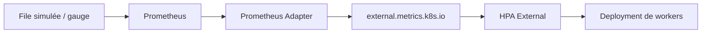

# Scénarios de démonstration — HPA Metrics POC

> **Statut :** storyboard de démonstration. Le socle FastAPI → Prometheus → Prometheus Adapter → API Custom Metrics a été validé. Les HPA, les scripts k6 et la chaîne External Metrics décrits ci-dessous restent à mettre en œuvre et à vérifier.
>
> **Objectif :** démontrer comment Kubernetes adapte le nombre de Pods selon différents signaux de charge, puis analyser les délais, les limites et les conditions d'éligibilité d'une application à l'autoscaling.

## 1. Cadre et règles communes

Le socle est construit selon [01-installation.md](01-installation.md). Les principes de fonctionnement sont décrits dans [03-architecture.md](03-architecture.md).

| Élément | Valeur du POC |
|---|---|
| Cluster | `kind-hpa-metrics-poc` |
| Namespace applicatif | `hpa-metrics-poc` |
| Deployment | `hpa-metrics-poc-app` |
| Service | `hpa-metrics-poc-svc` |
| API Custom Metrics | `custom.metrics.k8s.io/v1beta1` |
| Métrique Custom | `http_requests_per_second` (par Pod, mode CPU) |
| Métrique source | `demo_http_requests_total` |
| Mesure RPS | `rate(...[1m])` |
| Point de départ | 1 replica, HPA absent |

**Précautions de démonstration :**

- **Un seul HPA à la fois** pour le Deployment ; ne pas faire concourir plusieurs autoscalers sur la même cible.
- Le `spec.replicas` du Deployment sert à l'initialisation. Une fois le HPA actif, éviter de réappliquer un manifeste qui force ce nombre pendant le test.
- L'accès par `kubectl port-forward svc/...` sert aux premiers essais. Pour une charge reproductible et la comparaison des replicas, préférer un générateur **dans le cluster** ou un point d'entrée stable ; vérifier que l'acheminement répartit réellement les requêtes. Un port-forward vers un Service peut rester attaché à un seul Pod pendant la session et fausser la démonstration multi-replicas.
- Les valeurs de replicas calculées ci-dessous sont **indicatives**, non garanties : tolérance, disponibilité des métriques, comportement HPA et délais d'initialisation interviennent.
- Une augmentation de replicas ne garantit ni une réduction de latence ni une augmentation du débit : cela dépend notamment de la capacité réelle de l'application et de l'absence de goulot externe.

### Tableau de bord de contrôle commun

Dans des terminaux distincts :

```bash
kubectl get pods -n hpa-metrics-poc -w
```

```bash
kubectl get hpa -n hpa-metrics-poc -w
```

```bash
kubectl get events -n hpa-metrics-poc --sort-by=.lastTimestamp
```

Pour examiner les décisions :

```bash
kubectl describe hpa -n hpa-metrics-poc
```

Requête PromQL de référence :

```promql
sum by (namespace, pod) (
  rate(demo_http_requests_total{namespace="hpa-metrics-poc",mode="cpu"}[1m])
)
```

Mesures à consigner pour chaque essai : RPS total réellement atteint, RPS par Pod, nombre de replicas désiré/réel, délai entre début de charge et premier scale-up, délai jusqu'aux Pods `Ready`, erreurs HTTP et latence p95.

## 2. Vue d'ensemble du storyboard

| Scénario | Question démontrée | Signal | Statut |
|---|---|---|---|
| S0 — État de référence | Kubernetes lit-il une métrique métier sans HPA ? | Custom Metrics API | Socle validé |
| S1 — Montée en charge RPS | Le HPA augmente-t-il les replicas sur RPS/Pod ? | Custom `Pods` | À réaliser |
| S2 — Retour à la normale | Le HPA réduit-il les replicas de manière stabilisée ? | Custom `Pods` | À réaliser |
| S3 — Comparaison CPU / RPS | Deux signaux produisent-ils des décisions différentes ? | CPU puis Custom | À réaliser |
| S4 — Charge par paliers et saturation | Comment la boucle réagit-elle à des paliers et à un pic ? | k6, Custom | À réaliser |
| S5 — Charge globale indépendante | Le HPA peut-il scaler sur une file simulée ? | External `AverageValue` | À concevoir et réaliser |
| S6 — Limites d'architecture | Où s'arrêtent les bénéfices du HPA ? | Readiness, warmup, goulots | À réaliser |

## 3. S0 — Vérifier le socle, sans HPA

**Intention :** distinguer exposition d'une métrique et pilotage d'un Deployment.

1. Vérifier qu'aucun HPA ne cible notre application :

   ```bash
   kubectl get hpa -n hpa-metrics-poc
   ```

2. Vérifier le Pod, sa santé et l'exposition de la métrique :

   ```bash
   kubectl get deployment,pods -n hpa-metrics-poc
   kubectl get --raw \
     '/apis/custom.metrics.k8s.io/v1beta1/namespaces/hpa-metrics-poc/pods/%2A/http_requests_per_second' \
     | python -m json.tool
   ```

**Observation déjà validée lors de la construction :** l'API a retourné une valeur `6614m`, soit **6,614 RPS**, pour un Pod sous charge. Cela ne prouve pas encore le fonctionnement d'un HPA.

**Message d'architecture :** Prometheus collecte ; Prometheus Adapter expose ; le HPA, s'il est créé, prend la décision de scaling.

## 4. S1 — Premier HPA sur les RPS par Pod

**Hypothèse :** en fixant un objectif de **5 RPS moyens par Pod**, une charge suffisamment élevée entraîne une augmentation du nombre de replicas.

### Préparation

Créer `autoscaling/hpa-custom-rps.yaml` (configuration proposée, pas encore validée) :

```yaml
apiVersion: autoscaling/v2
kind: HorizontalPodAutoscaler
metadata:
  name: hpa-metrics-poc-rps
  namespace: hpa-metrics-poc
spec:
  scaleTargetRef:
    apiVersion: apps/v1
    kind: Deployment
    name: hpa-metrics-poc-app
  minReplicas: 1
  maxReplicas: 5
  metrics:
    - type: Pods
      pods:
        metric:
          name: http_requests_per_second
        target:
          type: AverageValue
          averageValue: "5"
  behavior:
    scaleUp:
      stabilizationWindowSeconds: 0
      policies:
        - type: Pods
          value: 2
          periodSeconds: 30
    scaleDown:
      stabilizationWindowSeconds: 60
      policies:
        - type: Pods
          value: 1
          periodSeconds: 30
```

Appliquer et vérifier :

```bash
kubectl apply -f autoscaling/hpa-custom-rps.yaml
kubectl get hpa hpa-metrics-poc-rps -n hpa-metrics-poc
kubectl describe hpa hpa-metrics-poc-rps -n hpa-metrics-poc
```

### Charge et observations

Pour un essai exploratoire, injecter des requêtes CPU en continu ; pour l'essai reproductible, utiliser le scénario k6 à débit d'arrivée constant décrit en S4.

Observer simultanément : le RPS mesuré, `TARGETS`, `DESIRED`, `CURRENT`, les événements HPA et les nouveaux Pods `Ready`.

**Exemple théorique :** avec 1 Pod mesurant 7 RPS et une cible de 5 RPS, le calcul de base donne `ceil(1 × 7/5) = 2` replicas. Le résultat réel peut différer à cause des règles HPA et des métriques manquantes.

**Point de vigilance majeur :** un générateur qui reste accroché au premier Pod peut laisser ses nouveaux voisins à `0 RPS`. Il faut valider la répartition de la charge pour interpréter l'équilibrage et les résultats.

### Critère de succès

Le HPA renseigne sa métrique, recommande plus d'un replica et le Deployment crée au moins un Pod supplémentaire qui devient `Ready`.

## 5. S2 — Scale-down et stabilisation

**Hypothèse :** après disparition de la charge, les RPS diminuent puis le HPA revient progressivement vers `minReplicas`.

Procédure :

1. Conserver le HPA de S1 et plusieurs Pods si la montée en charge a fonctionné.
2. Arrêter la génération de trafic.
3. Observer la baisse du RPS dans Prometheus puis dans `kubectl get hpa -w`.
4. Mesurer le délai jusqu'au retour à un replica.

**Interprétation :** deux temporisations se superposent : la fenêtre PromQL d'une minute et la fenêtre HPA de stabilisation à la baisse (`60s` dans notre manifeste). Il faut aussi tenir compte de la fréquence de collecte, de la réconciliation HPA et d'éventuelles métriques manquantes. **Ne pas interpréter 60 secondes comme un délai de descente garanti.**

**Critère de succès :** retour vers un seul replica sans oscillations répétées non expliquées.

## 6. S3 — Comparer HPA CPU et HPA RPS

**Objectif :** montrer qu'une métrique de ressources et une métrique applicative ne décrivent pas le même phénomène.

**Prérequis :** installer et vérifier Metrics Server (il n'est pas fourni automatiquement par Prometheus) :

```bash
kubectl top pods -n hpa-metrics-poc
kubectl get apiservice v1beta1.metrics.k8s.io
```

Si ces commandes échouent, **ne pas lancer S3** avant d'avoir établi `metrics.k8s.io`.

Préparer `autoscaling/hpa-cpu.yaml` avec `autoscaling/v2`, `minReplicas: 1`, `maxReplicas: 5` et une métrique `Resource` CPU à une cible de **60 % de la request** (`100m` actuellement). Ce seuil correspond à environ `60m` de CPU moyen par Pod, et non à 60 % de la limite CPU.

Exécuter les expériences **successivement**, jamais avec les deux HPA actifs :

```bash
kubectl delete -f autoscaling/hpa-custom-rps.yaml --ignore-not-found
kubectl scale deployment/hpa-metrics-poc-app --replicas=1 -n hpa-metrics-poc
kubectl apply -f autoscaling/hpa-cpu.yaml
```

Tester une charge CPU, consigner replicas/latence/RPS, puis revenir à l'état initial :

```bash
kubectl delete -f autoscaling/hpa-cpu.yaml --ignore-not-found
kubectl scale deployment/hpa-metrics-poc-app --replicas=1 -n hpa-metrics-poc
kubectl apply -f autoscaling/hpa-custom-rps.yaml
```

Rejouer un **profil de charge identique** et comparer. Compléter par un test `mode=io` : notre règle Custom filtre `mode="cpu"`, donc ce second profil ne peut pas être utilisé tel quel pour démontrer la supériorité d'un autoscaling métier. Une comparaison I/O équitable nécessiterait une règle Custom englobant ce trafic ou une métrique de concurrence distincte.

**Message d'architecture :** choisir un signal en fonction de la capacité réellement limitante, et non de sa seule disponibilité.

## 7. S4 — Charges reproductibles avec k6

**Objectif :** remplacer la boucle `curl` séquentielle par un trafic dont le débit offert est contrôlé, et mettre en évidence les délais de réaction.

### Préparation

Préférer un exécuteur k6 **`constant-arrival-rate`** ou **`ramping-arrival-rate`**, qui pilote le rythme de démarrage des itérations indépendamment du temps de réponse. Vérifier que le nombre de VUs disponibles suffit à tenir le débit voulu.

Deux parcours sont possibles :

- **Exploration locale :** k6 depuis le poste via un port-forward, utile pour tester les scripts mais insuffisant pour démontrer sans réserve la répartition entre plusieurs Pods.
- **Démonstration multi-replicas :** k6 lancé dans le cluster contre `http://hpa-metrics-poc-svc.hpa-metrics-poc.svc.cluster.local/work`, pour passer par le Service et ses endpoints.

Exemple de scénario **à créer** dans `load-tests/constant-load.js` :

```javascript
import http from 'k6/http';

const baseUrl = __ENV.BASE_URL || 'http://localhost:8081';
const rate = Number(__ENV.RATE || 12);

export const options = {
  discardResponseBodies: true,
  scenarios: {
    charge: {
      executor: 'constant-arrival-rate',
      rate,
      timeUnit: '1s',
      duration: '4m',
      preAllocatedVUs: 10,
      maxVUs: 50,
    },
  },
};

export default function () {
  http.get(`${baseUrl}/work?mode=cpu&duration_ms=100`);
}
```

Pour un essai local préliminaire (k6 installé et port-forward actif) :

```bash
k6 run -e BASE_URL=http://localhost:8081 -e RATE=12 load-tests/constant-load.js
```

**Attention :** ceci est un exemple de script, non un test déjà exécuté. L'exécution dans le cluster, le packaging et le suivi des résultats k6 restent à construire.

### Paliers proposés

| Phase | Débit offert indicatif | Intention |
|---|---:|---|
| Baseline | 2 RPS | Pas de scaling attendu |
| Palier 1 | 8 RPS | Premier scale-up possible |
| Palier 2 | 15 RPS | Scaling supplémentaire possible |
| Pic | 25 RPS | Observer les retards et erreurs éventuelles |
| Retour | 0–2 RPS | Stabilisation et scale-down |

Les paliers sont **des hypothèses à calibrer**, pas des seuils garantissant un nombre exact de replicas. Mesurer le débit **effectivement réalisé**, les itérations abandonnées, les codes HTTP, la latence p95 et les limites CPU.

### Critères de succès

Reconstituer une chronologie datée : arrivée de la charge → hausse de la métrique → recommandation HPA → création du Pod → Pod `Ready` → éventuelle modification de latence et débit.

## 8. S5 — External Metrics : une file de travail simulée

**Statut : scénario conceptuel, non encore implémenté.** Le POC actuel n'expose aucune External Metric (`rules.external: []`).

**Question :** le HPA peut-il augmenter les replicas selon une charge globale, non attribuée individuellement à des Pods ?

### Modèle cible

Une source (simulateur de file ou petit producteur de métriques) publiera une gauge de type `demo_queue_messages_pending`, collectée par Prometheus. Une règle **External** de Prometheus Adapter exposera `queue_messages_pending` via `external.metrics.k8s.io`. Le HPA utilisera `type: External`, `target.type: AverageValue`.



**Exemple pédagogique :** si la file contient 450 messages et que la cible est de 100 messages par Pod (`AverageValue`), le calcul de base conduit à `ceil(450/100) = 5` replicas, sous réserve des règles du HPA.

### Préparation restant à faire

1. Définir la sémantique de la file et sa consommation réelle : une gauge manipulée manuellement illustre la boucle, mais pas le fonctionnement d'un système de workers.
2. Ajouter la série à la collecte Prometheus et configurer `rules.external`.
3. Vérifier `v1beta1.external.metrics.k8s.io` et interroger la valeur depuis Kubernetes.
4. Créer `autoscaling/hpa-external-queue.yaml`, puis générer une montée de backlog.
5. Observer la descente lorsque le backlog se résorbe.

**Point de comparaison :** Custom `Pods` reflète une métrique associée à chaque Pod ; External reflète une valeur globale, éventuellement issue d'un système hors cluster. Leur source technique peut pourtant être la même : Prometheus.

## 9. S6 — Limites et critères d'architecture

Ce scénario est une **discussion structurée à partir des mesures**, plutôt qu'un résultat présumé.

| Sujet | Manipulation ou observation | Message à retenir |
|---|---|---|
| Readiness | Observer l'instant de passage `Ready` des nouveaux Pods | `Ready` doit signifier apte à traiter, pas seulement HTTP 200 |
| Warmup | Ajouter ultérieurement un délai de démarrage simulé | Un Pod créé n'apporte pas immédiatement de capacité utile |
| Mesure | Comparer début du trafic, `rate[1m]` et métrique HPA | Le signal est retardé par les fenêtres de collecte et de décision |
| Répartition | Comparer RPS par Pod sous charge distribuée | Le gain dépend de l'équilibrage effectif |
| Limite de replicas | Pousser la charge au-delà de `maxReplicas` | Le HPA ne crée pas une capacité infinie |
| Throttling / gateway | Discuter un goulot situé en amont, par exemple APIM | Ajouter des Pods ne corrige pas une limitation de gateway |
| Fiabilité | Relever erreurs, p95 et débits avant/après | Le scaling est un moyen, pas un SLO à lui seul |

## 10. Synthèse et traçabilité des résultats

Pour chaque scénario, renseigner après exécution :

| Champ | Valeur à relever |
|---|---|
| Date / version du POC | À compléter |
| Scénario / fichier HPA | À compléter |
| Profil k6 et débit réel | À compléter |
| RPS moyen et pic par Pod | À compléter |
| Replicas initiaux / maximaux observés | À compléter |
| Délai de scale-up / Ready / scale-down | À compléter |
| Erreurs HTTP et latence p95 | À compléter |
| Résultat et interprétation | À compléter |

### Nettoyage entre scénarios

Supprimer le HPA actif **avant** de redimensionner manuellement le Deployment :

```bash
kubectl get hpa -n hpa-metrics-poc
# Puis supprimer explicitement le HPA utilisé dans le scénario.
kubectl scale deployment/hpa-metrics-poc-app --replicas=1 -n hpa-metrics-poc
```

Ne supprimer ni Prometheus, ni Prometheus Adapter entre les démonstrations : ils constituent le socle partagé.

## Références

- [Kubernetes — Horizontal Pod Autoscaling](https://kubernetes.io/docs/concepts/workloads/autoscaling/horizontal-pod-autoscale/)
- [Prometheus Adapter — Configuration](https://github.com/kubernetes-sigs/prometheus-adapter/blob/master/docs/config.md)
- [Grafana k6 — Scénarios](https://grafana.com/docs/k6/latest/using-k6/scenarios/)
- [Grafana k6 — Constant arrival rate](https://grafana.com/docs/k6/latest/using-k6/scenarios/executors/constant-arrival-rate/)
