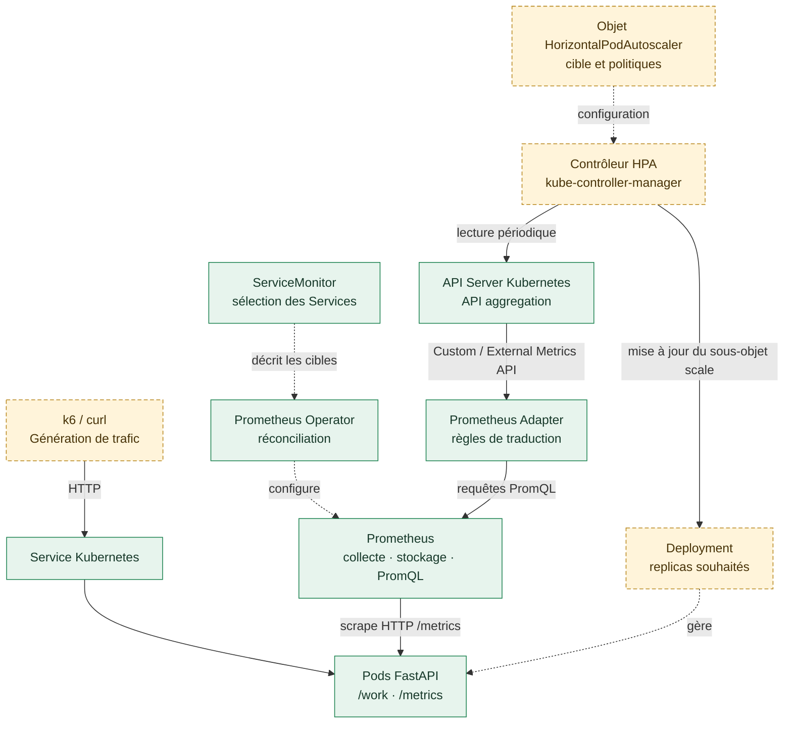
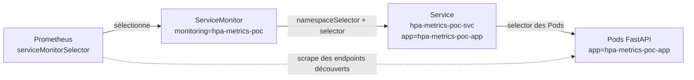
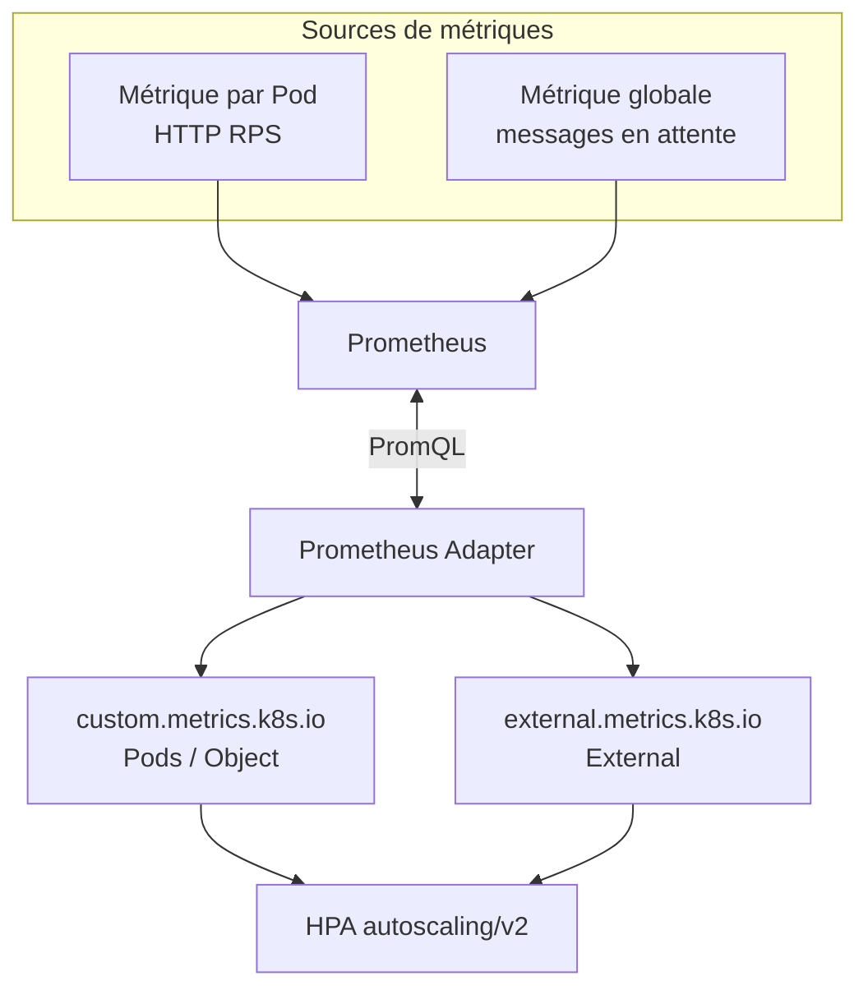
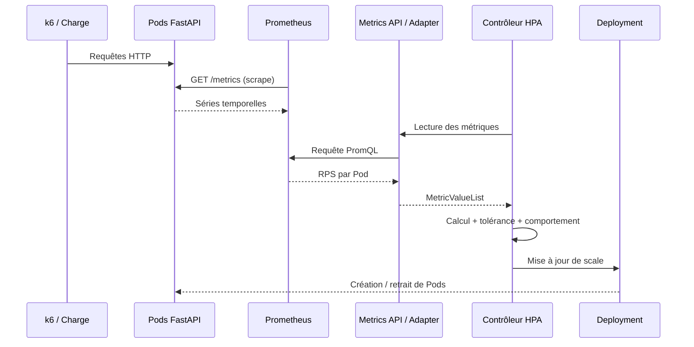

# Architecture du POC HPA — métriques personnalisées et externes

## 1. Objectif et périmètre

Ce POC démontre qu'un **Horizontal Pod Autoscaler (HPA)** Kubernetes peut ajuster le nombre de réplicas à partir de métriques applicatives ou de charge externe, **sans KEDA**, au moyen des APIs de métriques Kubernetes.

Le socle déjà validé couvre : FastAPI instrumentée, découverte par `ServiceMonitor`, collecte Prometheus, transformation par Prometheus Adapter et lecture de `http_requests_per_second` via l'API Kubernetes `custom.metrics.k8s.io`. L'autoscaling effectif et les métriques externes constituent les prochains scénarios de démonstration.

Ce document décrit **pourquoi les composants existent et comment ils interagissent**. Les commandes reproductibles figurent dans [01-installation.md](01-installation.md) et les manipulations de charge et HPA dans [02-demonstration.md](02-demonstration.md).

## 2. Vue d'ensemble



> **Lecture :** les flèches pleines indiquent les échanges ou consultations. Les flèches pointillées indiquent la configuration ou la gestion. Les composants HPA et les scénarios de charge seront validés dans le storyboard. Le contrôleur HPA fait déjà partie du plan de contrôle Kubernetes ; ce qui reste à valider est sa boucle de décision pour notre application.

**Point clé :** Prometheus **scrape** l'application (pull) ; Prometheus Adapter **interroge** Prometheus ; le contrôleur HPA **interroge** les APIs Kubernetes. Ce n'est pas Prometheus qui pousse directement des ordres au HPA.

## 3. Responsabilités et frontières

| Composant | Responsabilité | Ne fait pas |
|---|---|---|
| **FastAPI + `prometheus-client`** | Exécuter les traitements, exposer compteurs et jauges sur `/metrics` | Décider du nombre de Pods |
| **Service Kubernetes** | Fournir une entrée réseau stable et sélectionner les Pods | Scraper ou stocker les métriques |
| **ServiceMonitor** | Décrire les Services, ports et intervalles à scraper | Stocker les métriques |
| **Prometheus Operator** | Réconcilier les ressources de monitoring et configurer Prometheus à partir des CRD | Calculer les réplicas HPA |
| **Prometheus** | Collecter les séries temporelles, stocker et exécuter PromQL | Publier nativement l'API Custom Metrics Kubernetes |
| **Prometheus Adapter** | Découvrir, associer, renommer et calculer des métriques exposées via les APIs Custom/External Metrics | Collecter périodiquement `/metrics` à la place de Prometheus |
| **API Server + API aggregation** | Exposer une interface Kubernetes homogène vers les adapters enregistrés | Définir la stratégie d'autoscaling |
| **Objet HPA (`autoscaling/v2`)** | Déclarer cible, métriques, seuils, min/max, politiques de montée/descente | Exécuter lui-même un contrôleur |
| **Contrôleur HPA** | Lire les métriques, calculer les réplicas souhaités, mettre à jour `scale` | Corriger un goulot d'étranglement extérieur aux Pods |
| **Deployment / ReplicaSet / scheduler** | Créer ou retirer les Pods selon le nombre désiré et les contraintes du cluster | Choisir les seuils métier |
| **k6** | Appliquer une charge reproductible et mesurer les réponses | Fournir intrinsèquement une métrique au HPA |

### 3.1 La découverte des Pods : deux sélections distinctes



Prometheus sélectionne le **ServiceMonitor**, lequel sélectionne les **Services**, lesquels sélectionnent les **Pods**. Le `ServiceMonitor` ne cible donc pas directement le `Deployment`. Son endpoint `port: http` désigne le **nom de port du Service**, et non un numéro de port arbitraire.

Dans le POC : `ServiceMonitor` dans `monitoring`, application dans `hpa-metrics-poc`, `scrapeInterval` de 10 secondes et endpoint `/metrics` sur le conteneur port 8000.

## 4. Trois familles d'APIs de métriques Kubernetes

| Famille | API | Types de source HPA | Exemple |
|---|---|---|---|
| **Resource Metrics** | `metrics.k8s.io` | `Resource`, `ContainerResource` | CPU, mémoire ; généralement via Metrics Server |
| **Custom Metrics** | `custom.metrics.k8s.io` | `Pods`, `Object` | RPS par Pod, trafic d'un Ingress |
| **External Metrics** | `external.metrics.k8s.io` | `External` | Profondeur globale d'une file de messages |

Ces APIs sont des **contrats de lecture côté Kubernetes**. Elles ne sont pas des bases de données et ne collectent pas elles-mêmes les séries. Un adapter doit prendre en charge les APIs Custom/External concernées ; les exposer n'est pas automatique dès qu'un Prometheus existe.

### 4.1 Custom Metrics versus External Metrics

La différence fondamentale est **l'association de la métrique à un objet Kubernetes** :

- **Custom / `Pods`** : une valeur par Pod sélectionné, que le HPA agrège généralement en moyenne. Ici, `http_requests_per_second` décrit chaque Pod FastAPI.
- **Custom / `Object`** : une valeur décrivant un objet Kubernetes identifié (par exemple un Ingress ou un Service), comparée à une cible `Value` ou `AverageValue`.
- **External** : la métrique n'a **pas besoin** d'être liée à un objet Kubernetes. Elle décrit, par exemple, une file de travail ou une charge globale, même si son producteur tourne lui-même dans Kubernetes.

**Il ne faut pas confondre « external » avec « hébergé en dehors du cluster ».** Une file simulée au sein de notre cluster peut fournir une External Metric si son exposition n'est pas associée à un objet Kubernetes.



| Question | Custom — `Pods` | External |
|---|---|---|
| À quoi est liée la valeur ? | À chaque Pod du workload | À une charge sans objet Kubernetes obligatoire |
| Que lit le HPA ? | Une mesure pour chaque Pod | Une mesure globale ou sélectionnée par labels |
| Cible pertinente | `AverageValue` | `Value` ou `AverageValue` |
| Exemple POC | 5 RPS par Pod | 100 messages en attente par Pod souhaité |
| Risque à maîtriser | Absence de mesure sur les Pods récents | Portée des métriques et droits d'accès à l'API externe |

L'API `external.metrics.k8s.io` est particulièrement sensible au cloisonnement : selon la configuration du fournisseur, elle peut exposer des métriques sans relation forte avec un namespace applicatif. Le choix des règles, filtres et habilitations doit rester explicite.

## 5. Chemin Custom Metrics effectivement validé

### 5.1 Production et collecte

L'application expose `demo_http_requests_total`, un **Counter** Prometheus étiqueté par `method`, `mode` et `status`. Les combinaisons `GET / cpu / 200` et `GET / io / 200` sont initialisées à zéro au démarrage du Pod afin que les séries existent avant les premières requêtes.

Prometheus collecte le compteur et lui associe notamment les labels de découverte Kubernetes `namespace` et `pod`. La requête de base du POC est :

```promql
sum by (namespace, pod) (
  rate(demo_http_requests_total{mode="cpu"}[1m])
)
```

Un Counter est cumulatif, tandis que `rate(...[1m])` produit un **débit moyen par seconde** sur une fenêtre glissante. Le calcul nécessite au moins deux échantillons ; l'initialisation à zéro ne supprime donc pas toute latence de disponibilité.

### 5.2 Rôle précis de l'adapter

La règle dans `infra/prometheus-adapter/values.yaml` réalise quatre opérations :

1. **Découverte** (`seriesQuery`) : sélectionner les séries du compteur en mode CPU.
2. **Association** (`resources.overrides`) : traduire les labels `namespace` et `pod` en identifiants de ressources Kubernetes.
3. **Nommage** (`name`) : exposer `http_requests_per_second` plutôt que le nom brut du Counter.
4. **Lecture** (`metricsQuery`) : construire la requête PromQL à exécuter à la demande de l'API.

Le **catalogue des métriques** et leur **valeur instantanée** sont deux vérifications distinctes : voir `pods/http_requests_per_second` dans la liste des ressources ne garantit pas que l'API retournera une valeur exploitable.

### 5.3 Résultat observé

Dans le POC, l'appel à :

```text
/apis/custom.metrics.k8s.io/v1beta1/namespaces/hpa-metrics-poc/pods/%2A/http_requests_per_second
```

a renvoyé une `MetricValueList` avec une valeur `6614m` pour un Pod, soit **6,614 requêtes par seconde**. La notation `m` exprime des milli-unités Kubernetes : ce n'est pas une durée en millisecondes.

**Jalon établi :** FastAPI → ServiceMonitor → Prometheus → Prometheus Adapter → API Custom Metrics Kubernetes. Aucun HPA n'était nécessaire à cette validation.

## 6. Boucle de décision du HPA



Pour une métrique `Pods` dont la cible est `AverageValue`, le principe du calcul est :

\[
N_{souhaité} = \left\lceil N_{actuel}\times\frac{M_{observée}}{M_{cible}}\right\rceil
\]

Exemple **illustratif** : un Pod reçoit 7 RPS pour une cible de 5 RPS par Pod ; la recommandation théorique est `ceil(1 × 7 / 5) = 2` Pods.

Ce résultat n'est **pas instantané ni garanti à chaque cycle** : le contrôleur tient notamment compte des métriques manquantes, de la tolérance, des Pods en cours de démarrage, des limites `minReplicas` / `maxReplicas` et des politiques de stabilisation.

Avec plusieurs métriques configurées, le HPA retient normalement la recommandation de replicas la plus élevée, sous réserve de ses règles de gestion des erreurs et des limites configurées. Il ne faut donc pas créer plusieurs HPA distincts qui pilotent simultanément le même Deployment : les scénarios doivent activer une seule politique à la fois.

### 6.1 `Value` et `AverageValue` pour une métrique externe

Pour une profondeur de file globale de **450 messages** :

- Avec `External` et `AverageValue: 100`, le HPA peut viser approximativement **5 Pods**, soit 100 messages en attente par Pod souhaité.
- Avec `External` et `Value: 100`, la comparaison porte sur **450 contre 100** en tant que valeur globale : à nombre de Pods actuel égal, le calcul suit le ratio global et n'exprime pas directement « 100 messages par Pod ».

L'interprétation du seuil est donc aussi importante que la provenance de la métrique.

## 7. Contraintes et points d'attention

| Sujet | Impact architectural / contrôle |
|---|---|
| **Latence de réaction** | Addition de la fréquence de scraping, des fenêtres PromQL, du cycle de contrôle HPA et du démarrage des Pods |
| **Initialisation des séries** | Précréer les compteurs étiquetés ; prévoir le délai nécessaire à `rate()` |
| **Répartition de charge** | Un Service répartit des connexions ou requêtes selon le contexte réseau ; la charge observée peut rester déséquilibrée entre Pods |
| **Readiness / warmup** | Un Pod démarré n'est pas nécessairement prêt pour la charge métier ; readiness adaptée et warmup éventuellement nécessaires |
| **CPU et concurrence** | Un débit RPS identique peut correspondre à des coûts CPU ou temps de traitement très différents |
| **Plafond amont (APIM / gateway)** | Un HPA ne résout pas le throttling ou la saturation d'une gateway située avant les Pods |
| **Capacité cluster** | Le Deployment peut demander plus de Pods que le scheduler ne peut effectivement placer |
| **Qualité des métriques** | Vérifier labels, périmètre d'agrégation, absence de double comptage et comportement en cas de données manquantes |
| **Sécurité / multi-tenancy** | Contrôler l'exposition des APIs de métriques, notamment des External Metrics globales |
| **Absence de KEDA** | Le HPA exploite directement les APIs standard, alimentées ici par Prometheus Adapter ; KEDA reste une alternative, pas une dépendance |

## 8. Portabilité et transposition vers Dynatrace

La **partie stable** de l'architecture est le contrat Kubernetes : HPA `autoscaling/v2`, noms des métriques, sémantique des valeurs et APIs `custom.metrics.k8s.io` / `external.metrics.k8s.io`.

La **partie interchangeable** est la chaîne qui fournit ces APIs. Dans ce POC, Prometheus collecte et Prometheus Adapter traduit. Une intégration Dynatrace devra disposer d'un **adapter ou d'une passerelle compatible** avec les APIs de métriques Kubernetes ; remplacer simplement l'URL de Prometheus par celle de Dynatrace ne suffit pas.

L'objectif de transposition est de conserver la définition des politiques HPA et de remplacer, si nécessaire, le fournisseur de métriques et ses règles de mapping, tout en vérifiant la même sémantique (unité, agrégation, fraîcheur et périmètre).

## 9. Périmètre de validation et documentation associée

| Capacité | État |
|---|---|
| FastAPI, ServiceMonitor et collecte Prometheus | **Validé** |
| Initialisation des compteurs à zéro | **Validé** |
| Découverte et lecture Custom Metrics Kubernetes | **Validé** |
| Déploiement HPA et scaling RPS effectif | **À démontrer** |
| Comparaison CPU / RPS | **À démontrer** |
| External Metrics et file simulée | **À démontrer** |
| Scénarios k6, performances et limites | **À démontrer** |

- [Installation reproductible](01-installation.md)
- [Storyboard de démonstration](02-demonstration.md)
- [Documentation HPA Kubernetes](https://kubernetes.io/docs/concepts/workloads/autoscaling/horizontal-pod-autoscale/)
- [API HPA `autoscaling/v2`](https://kubernetes.io/docs/reference/kubernetes-api/autoscaling/horizontal-pod-autoscaler-v2/)
- [Configuration de Prometheus Adapter](https://github.com/kubernetes-sigs/prometheus-adapter/blob/master/docs/config.md)
- [Fonctionnement de Prometheus Operator](https://prometheus-operator.dev/docs/getting-started/design/)
